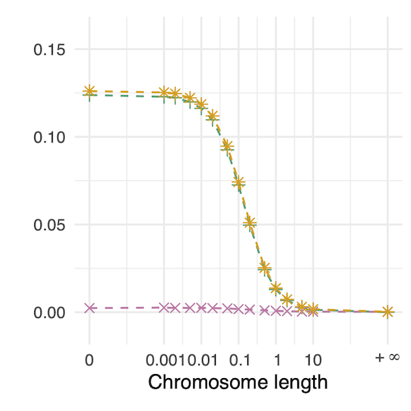
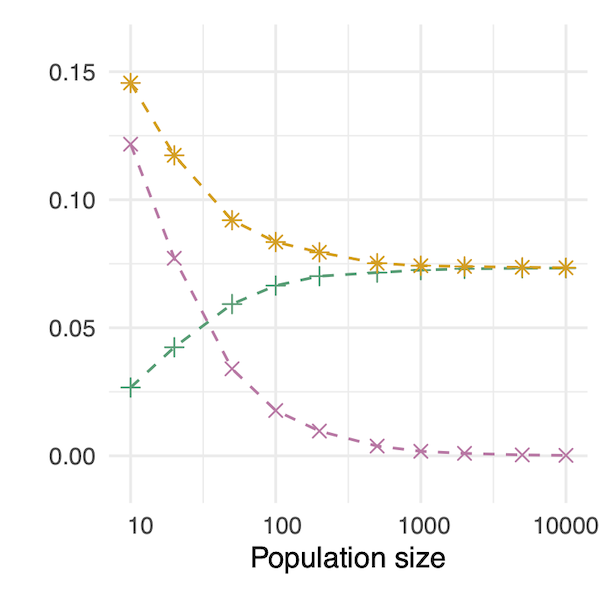
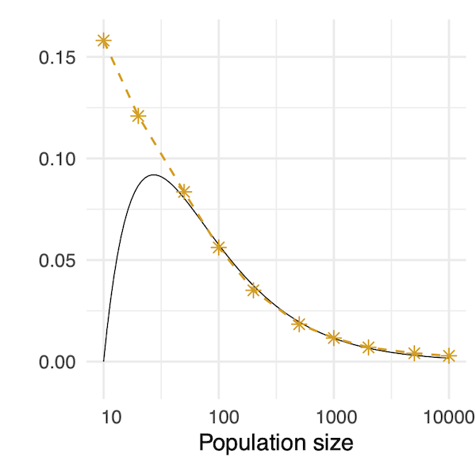
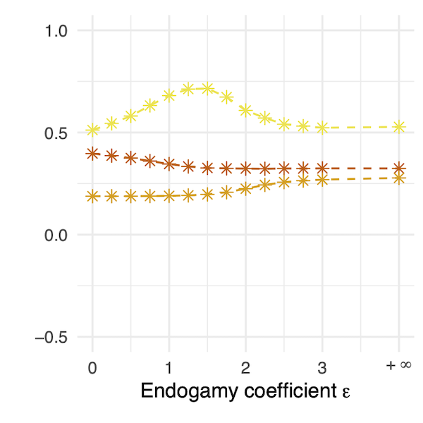
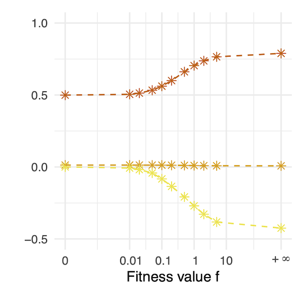

# Simulator for admixture histories with explicit mating patterns

Code used for simulating admixture histories with fixed pedigrees in [Gaspard Dousson Lys, Camille Coron, Tristan Mary-Huard, Paul Verdu. How shared pedigrees shape gene genealogies in finite admixed populations. 2026.](https://hal.science/hal-05862261v1)

## Installation

The scripts can be downloaded and used by importing the `Simulation` class (**Quick start**) or the `AdmixtureFractionHistory` and `AdmixtureHistory` classes (**Advanced usage**).

## Quick start

The `Simulation` class manages the simulation of admixture histories. After importing the class, users initialize it with the desired parameters and call the `measure` method to obtain admixture fractions or continuous ancestry tract lengths across multiple independent realization of the specified admixture history.

The number of generations and source populations is inferred implicitly: the former corresponds to the length of the population sizes list and the number of columns in the contribution matrix, and the latter to the number of rows in the contribution matrix.

The `SimulationFromPrior` class manages the simulation of independent and identically distributed admixture histories. After importing the class, users initialize it with a prior, represented as a function taking no argument and returning the same parameters as for the `Simulation` class. The `measure` method returns the results of multiple indepedent realization of admixture histories drawn from the prior. To know which parameters where sampled from the prior, note that the replicate index of an admixture history is also the seed used when calling the prior.

### Example.

In the following example, we simulate ten independent realizations of an admixture history. Two source populations contribute $75\%$ and $25\%$, respectively, to the founding of an admixed population. The population then remains isolated for three additional generations (up to the present $\tau = 4$), undergoing a bottleneck at generation $t = 3$, during which the population size decreases from $1000$ to $200$ individuals, recovering to $1000$. We record admixture fractions of twenty present-day admixed individuals.

```python
from simulation import Simulation

contrib = [
    [0.75, 0.0, 0.0, 0.0],           # S1 contributes 75% before isolation
    [0.25, 0.0, 0.0, 0.0]            # S2 contributes 25% before isolation
]

pop_sizes = [1000, 1000, 200, 1000] # a bottleneck scenario

chr_lengths = [1]                   # individuals carry one chromosome pair, of length 1 Morgan

simulation = Simulation(contrib, pop_sizes, chr_lengths)
data, labels = simulation.measure(rep_nb=10, size=20, param=False, adm_frac=True)
```

After running the code above, inspection of the output shows that the first admixed individual in the first replicate has exactly half of its ancestry from population source $S_1$ (`data[0]`), whereas the second individual exhibits almost exclusively ancestry from this source (`data[2]`, $> 93\%$).

The output of `Simulation.measure` is stored in long format: the second replicate follows the first, and thus occupies indices from `40` to `79`, corresponding to the $40$ admixture fractions measured in each replicate. In total, the number of measured admixture fractions is $2$ (number of source population) $\times 20$ (sampled individuals) $\times 10$ (replicates), yielding $4000$ rows in `data`.

By default, mating follows a biparental Wright-Fisher model with admixture. Alternative mating patterns can be simulated using the implemented toy models for endogamy and selection (see **Figures**). A brief introduction to designing custom mating patterns is provided in **Advanced usage**. However, this functionality was not a primary design goal, and the corresponding method is therefore not user-friendly.

## Advanced usage

This section describes how to run simulations without relying on the simplifying but restrictive `Simulation` class. Depending on whether chromosome length (or crossover intensity) is finite, one can use either the `AdmixtureHistory` class, which simulates the splitting and merging of chromosome paintings, or the `AdmixtureFractionHistory` class, which simulates perfectly mixed admixture fractions.

In both cases, the `sample` method returns a list of sampled individuals, each providing a `get_admixture_fraction` method to retrieve their admixture fraction. When crossover intensity is finite, continuous ancestry tracts can also be analyzed using the `get_chromosome` method, which returns a list of `Chromosome` objects for each individual, and then the `get_origins_between` method to extract tracts (or `to_text` for a fast printable visualization).

### Stucture of `AdmixtureHistory`.

The `AdmixtureHistory` class builds on `GeneticPedigree`, which in turn inherits attributes and methods from `Pedigree`. The `AdmixtureFractionHistory` class relies solely on the `Pedigree`, as no recombination needs to be modeled for perfectly mixed genomes.

The `Pedigree` class encodes all parental relationships among admixed individuals. Its primary method, `get_kinship_of`, computes, stores and returns the two parents of a given individuals. The endogamy toy model is implemented at this level, as it depends only on genealogical relationships.

The `GeneticPedigree` class extends `Pedigree` with the `get_recombination_event` method, which computes, stores and returns recombination events, that is, the transmitted chromosome and crossover points along the pair. The selection toy model is implemented at this level, as it relies on genetic information.

When the `sample` method is called, individuals are drawn and their chromosomes (or admixture fractions) are computed recursively according to the parental relationships and recombination events defined by the underlying `GeneticPedigree` (or `Pedigree`).

### Example.

We replicate the example from **Quick start**, but this time we assume that the source population $S_1$ actually consists of two isolated subpopulations, $S_{1,1}$ and $S_{1,2}$, contributing $50\%$ and $25\%$, respectively, to the foundation. We simulate a single realization of the three-source admixture history and sample chromosomes from it.

```python
from admixture_history import AdmixtureHistory

from numpy import random
random.seed(0)      # the Simulation class uses the replicate index as a seed, thus 0 corresponds to the previously described data[0] and data[2]

contrib = [
    [0.50, 0.0, 0.0, 0.0],  # S11
    [0.25, 0.0, 0.0, 0.0],  # S12
    [0.25, 0.0, 0.0, 0.0]   # S2
]
pop_sizes = [1000, 1000, 200, 1000]
chr_lengths = [1]

simulation = AdmixtureHistory(contrib, pop_sizes, chr_lengths)
sample = simulation.sample()            # by default, one individual is sampled
individual = sample[0]
chr1 = individual.get_chromosome(0, 1)  # first chromosome of the “0th” pair
chr2 = individual.get_chromosome(0, 2)  # second chromosome of the “0th” pair
```

Once a `Chromosome` is selected, two primary methods are available: `get_admixture_fraction` (where an individual's admixture fraction is computed as the length-weighted mean across its chromosomes) and `get_origins_between`, which returns a list of tracts represented by their bounds and origin (in terms of source population).

Quick visualizations can be obtained by printing `chr1.to_text()` and `chr2.to_text()`. This reveals that the sampled individual inherits one chromosome (`chr1`) entirely from source population $S_2$, while the other (`chr2`) is admixed, mainly from $S_{1,1}$ with a small contribution from $S_{1,2}$.

### New mating patterns.

Simulations were not originally designed for custom mating patterns. While this is possible, it basically requires overwritting the `get_kinship_of` method. As an illustration, we describe the implementation of the endogamy toy model within the `Pedigree` class.

First, two static methods define the target probability distribution: `normalize` converts weights to probabilities, and `boltzmann_gibbs_distribution` uses these to generate a Boltzmann-Gibbs type distribution.

Next, the auxiliary method `_get_tlca_of` computes the time to the last common ancestor (TLCA) between two individuals and stores it in an auxiliary attribute `tlca`. The `_draw_relative_of` method then collect all TLCAs for a given individual within its generation, constructs a Boltzmann-Gibbs distribution specified by the `endogamy` parameter, and draws a mate accordingly.

Finally, `get_kinship_of` is implemented such that, when `endogamy` is non-zero (default to zero) and both parents are admixed, the first is drawn uniformly and the second using `_draw_relative_of` with respect to the first, thus following the proposed toy model for endogamy.

A similar approach is applied at the `GeneticPedigree` level for the selection toy model. Here, an auxiliary attribute `mutant` tracks alleles under selective pressure, and parents are drawn with the deduced fitness as weights.

## Figures

This section provides all parameter settings used to generate the figures in [Gaspard Dousson Lys, Camille Coron, Tristan Mary-Huard, Paul Verdu. How shared pedigrees shape gene genealogies in finite admixed populations. 2026.](https://hal.science/hal-05862261v1) Simulations were performed using the `Simulation` class on a computing cluster. They are not intended for personal computers without reducing the number of independent replicates (`rep_nb`).

In all histories, two source populations contribute `s1(0)` and `1-s1(0)`, respectively, to the founding of an admixed population, and subsequently contribute at constant rate `s1` and `s2` over `gen_nb-1` additional generations. The admixed population maintains a constant size `pop_size` and consists of diploid individuals, each carrying a single pair of chromosomes of length `chr_length` (relative to a unit crossover intensity). Simulations are performed over `rep_nb` replicates, with (unless otherwise specified) default `endogamy` ($0$) and `selection` ($0$) parameters, corresponding to Wright-Fisher mating.

### Chromosome length (Figure 5, left).

The within-population (green), across-replicates (pink) and total (orange) variances are shown as functions of the chromosome length.



| `rep_nb` | `gen_nb` | `s1(0)` | `s1(t)` | `s2(t)` | `pop_size` | `chr_length` |
|:--------:|:--------:|:-------:|:-------:|:-------:|:----------:|:------------:|
| 1000     | 20       | 0.5     | 0.0     | 0.0     | 1000       | 0.0          |
|          |          |         |         |         |            | 0.001        |
|          |          |         |         |         |            | 0.002        |
|          |          |         |         |         |            | 0.005        |
|          |          |         |         |         |            | 0.01         |
|          |          |         |         |         |            | 0.02         |
|          |          |         |         |         |            | 0.05         |
|          |          |         |         |         |            | 0.1          |
|          |          |         |         |         |            | 0.2          |
|          |          |         |         |         |            | 0.5          |
|          |          |         |         |         |            | 1.0          |
|          |          |         |         |         |            | 2.0          |
|          |          |         |         |         |            | 5.0          |
|          |          |         |         |         |            | 10.0         |
|          |          |         |         |         |            | inf          |

### Population size (Figure 5, center).

The within-population (green), across-replicates (pink) and total (orange) variances are shown as functions of the population size.



| `rep_nb` | `gen_nb` | `s1(0)` | `s1(t)` | `s2(t)` | `pop_size` | `chr_length` |
|:--------:|:--------:|:-------:|:-------:|:-------:|:----------:|:------------:|
| 1000     | 20       | 0.5     | 0.0     | 0.0     | 10         | 0.1          |
|          |          |         |         |         | 20         |              |
|          |          |         |         |         | 50         |              |
|          |          |         |         |         | 100        |              |
|          |          |         |         |         | 200        |              |
|          |          |         |         |         | 500        |              |
|          |          |         |         |         | 1000       |              |
|          |          |         |         |         | 2000       |              |
|          |          |         |         |         | 5000       |              |
|          |          |         |         |         | 10000      |              |

### Stationarity (Figure 5, right).

The total stationary variance is shown as function of the population size, along with the function $x \mapsto \log(0.1 x)/0.4x$.



| `rep_nb` | `gen_nb` | `s1(0)` | `s1(t)` | `s2(t)` | `pop_size` | `chr_length` |
|:--------:|:--------:|:-------:|:-------:|:-------:|:----------:|:------------:|
| 1000     | 100      | 0.5     | 0.0     | 0.0     | 10         | 0.1          |
| 1000     | 200      |         |         |         | 20         |              |
| 1000     | 300      |         |         |         | 50         |              |
| 1000     | 400      |         |         |         | 100        |              |
| 1000     | 500      |         |         |         | 200        |              |
| 1000     | 600      |         |         |         | 500        |              |
| 1000     | 700      |         |         |         | 1000       |              |
| 1000     | 900      |         |         |         | 2000       |              |
| 100      | 1100     |         |         |         | 5000       |              |
| 100      | 1300     |         |         |         | 10000      |              |

### Endogamy (Figure 6, left).

The within-population moments (expectation in red, variance in orange and skewness in yellow) are shown as functions of the endogamy coefficient.



| `rep_nb` | `gen_nb` | `s1(0)` | `s1(t)` | `s2(t)` | `pop_size` | `chr_length` | `endogamy` |
|:--------:|:--------:|:-------:|:-------:|:-------:|:----------:|:------------:|:----------:|
| 1000     | 20       | 0.0     | 0.05    | 0.0     | 1000       | 1.0          | 0.0        |
|          |          |         |         |         |            |              | 0.25       |
|          |          |         |         |         |            |              | 0.5        |
|          |          |         |         |         |            |              | 0.75       |
|          |          |         |         |         |            |              | 1.0        |
|          |          |         |         |         |            |              | 1.25       |
|          |          |         |         |         |            |              | 1.50       |
|          |          |         |         |         |            |              | 1.75       |
|          |          |         |         |         |            |              | 2.0        |
|          |          |         |         |         |            |              | 2.25       |
|          |          |         |         |         |            |              | 2.50       |
|          |          |         |         |         |            |              | 2.75       |
|          |          |         |         |         |            |              | 3.0        |
|          |          |         |         |         |            |              | inf        |

### Fitness (Figure 6, right).

The within-population moments (expectation in red, variance in orange and skewness in yellow) are shown as functions of the fitness coefficient.



| `rep_nb` | `gen_nb` | `s1(0)` | `s1(t)` | `s2(t)` | `pop_size` | `chr_length` | `fitness` |
|:--------:|:--------:|:-------:|:-------:|:-------:|:----------:|:------------:|:---------:|
| 1000     | 20       | 0.5     | 0.0     | 0.0     | 1000       | 1.0          | 0.0       |
|          |          |         |         |         |            |              | 0.01      |
|          |          |         |         |         |            |              | 0.02      |
|          |          |         |         |         |            |              | 0.05      |
|          |          |         |         |         |            |              | 0.1       |
|          |          |         |         |         |            |              | 0.2       |
|          |          |         |         |         |            |              | 0.5       |
|          |          |         |         |         |            |              | 1.0       |
|          |          |         |         |         |            |              | 2.0       |
|          |          |         |         |         |            |              | 5.0       |
|          |          |         |         |         |            |              | inf       |
